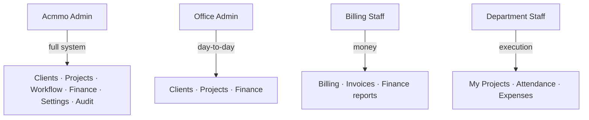

# ACMMO Office Management System — Portfolio Case Study

**Custom web application for an architecture, interiors, and construction firm**

Use the sections below on a portfolio project detail page. Copy the **Short summary** and **One-liner** as-is, or trim to fit your layout.

---

## At a glance

| Field | Detail |
|--------|--------|
| **Product name** | ACMMO Office Management System |
| **Industry** | Architecture / interiors / construction (Kerala, India) |
| **Product type** | Internal operations platform (admin + staff portals) |
| **Currency & locale** | INR (₹), Kerala districts, company-branded PDFs |
| **Status** | Production-ready (September 2026) |
| **Your role** | *[Fill in: e.g. Full-stack developer — design, build, deploy]* |

### One-liner (hero subtitle)

End-to-end office platform: clients and projects from first enquiry through departmental workflow, billing, dual finance ledgers, GPS attendance, and printable project sheets and invoices.

### Short summary (2–3 sentences for portfolio body)

ACMMO Office replaces spreadsheets, WhatsApp threads, and paper checklists with one secure web app. Super admins and office managers track every job through configurable services and admin review gates; department staff work in a focused portal with documents, KMAP areas, and files. Billing staff and finance modules handle invoices, payments, project P&amp;L, and office cash—while attendance uses GPS geofencing at the office.

### Tags / skills (for filters)

`Next.js` · `React` · `TypeScript` · `MySQL` · `Tailwind CSS` · `RBAC` · `Workflow engine` · `PDF generation` · `Excel export` · `GPS attendance` · `Finance ledger` · `Invoicing`

---

## Problem

The client ran a multi-department architecture office where work handoffs (planning → permit → 3D → estimation → billing) depended on memory, phone calls, and informal tracking. Pain points included:

- No single view of **which project is with which department** or waiting for admin approval
- **Client and project data** scattered across registers; duplicate phone numbers and missing documents on site visits
- **Billing and collections** disconnected from project progress
- **Office cash vs project money** mixed in informal books
- **Staff attendance** with no reliable, location-aware record
- Need for **professional printouts** (project sheets, invoices) matching company branding exactly

---

## Solution

A role-based **Next.js** application with two experiences:

1. **Admin console** — dashboard, clients, projects, workflow control, billing, invoices, finance, attendance reports, settings, security, and audit.
2. **Staff portal** — assigned work queue, project detail (checklist, files, KMAP, drawing numbers), submit for review, return to office, attendance, expense claims, profile.

Projects are created as **full package** or **custom services**; the workflow timeline is generated from the service catalog so each job only shows the stages that apply.

---

## Feature overview (portfolio-friendly)

### Operations & CRM

- **Client directory** — name, phone (unique), email, address, Kerala district, Aadhaar and linked numbers, project history
- **Combined registration** — create client + project in one flow for walk-ins
- **Search and filters** — district, has projects, source, debounced text search

### Project lifecycle

- **Auto codes** — `PROJECT-YYYY-####`, reserved invoice numbers `INV-YYYY-####`
- **Rich project profile** — location, type (residential/commercial/…), priority (high-visibility UI), start/due dates, refer name, MBook number, unique drawing number, notes
- **Status flags** — site visit pending, under construction, plinth-level inspection (dashboard KPIs and deep links)
- **Project list** — filters by status, department, attention queue, delayed, URL-driven dashboard filters; configurable page size
- **Print / PDF** — project sheet on create and on demand from project header

### Configurable workflow engine

- **Service catalog** — core and add-on services (e.g. plinth-level inspection); inactive services hidden from new projects
- **Per-service pipeline** — service work → **admin review** → next department; final **billing** stage
- **Department assignment** — assign staff, approve, reject (correction required), reassign, move department, close when paid
- **Staff actions** — start work, mark complete, submit for review, return with predefined reasons
- **Timeline & progress** — visual workflow on project detail; department progress sidebar
- **Notifications** — assignment, section handoff, return, ready for review; bell + notification center

### Documents & field data

- **Document templates** per service (admin-configurable checklist suggestions)
- **Project checklist** — track filed/review status; not a hard gate (office practice)
- **File metadata** — track uploads/references by type
- **KMAP** — floor-wise plinth and floor area (sq ft), add floors up to 50, running totals
- **Custom fields** — office-defined extra questions on new projects

### Billing & invoicing

- **Project billing tab** — contract amount, advance, balance; auto payment status (Unpaid / Partially Paid / Paid)
- **Payment methods** — Cash, Bank Transfer, UPI, Cheque, Card
- **Billing dashboard** — unpaid, partial, paid queues aligned with payment records
- **Invoice module** — line items, discounts, statuses (Draft through Cancelled), PDF with **company name from settings character-for-character**
- **Billing staff scope** — billing-stage projects and finance views without full office finance admin

### Finance (dual ledger)

**Project finance** — income (advance, stage, final, consultation, drawing, permit, other), expenses, budget vs actual, ledger, profit analysis, Excel reports (monthly, payments, income, expenses, profit).

**Office finance** — office income/expenses, cash book, accounts (cash, petty, bank, UPI), vendors, staff claim approval, salary workflow (draft → approved → paid), categories/settings, office reports.

Quick actions from project detail: **Add income** / **Add expense** with project pre-selected; create client from finance forms when needed.

### Attendance & expenses

- **GPS geofenced check-in/out** (default 300 m radius), server-side distance validation, one punch per day per direction
- **Late coming** — configurable office start time + buffer; staff alert on late check-in
- **Admin attendance** — date/month/staff/department filters, CSV/Excel export, print, manual mark for site visits
- **Staff expense claims** — submit and track through office finance claims flow

### Administration & security

- **Role hierarchy** — Acmmo Admin (super), Office Admin, Billing Staff, multi-role department staff (Planning, Permit, 3D, Estimation, custom departments)
- **Role-based home routes** — dashboard, projects, billing, or staff home
- **User & admin management** — create staff/admins, activate/deactivate, bcrypt passwords
- **Company settings** — logo, GST, bank/UPI, invoice terms, tagline (feeds PDFs)
- **Audit logs** — privileged actions with role and IP where captured
- **Security** — HTTP-only session cookie (7-day), action-level authorization guards

### Dashboard & analytics

- **Clickable KPI cards** — clients, active, awaiting assignment, pending review, correction, attention, plinth inspection, under construction, site visit pending, completed/closed, payments pending, delayed
- **Charts** — status breakdown, department analytics, 6-month revenue trend
- **Operational lists** — needs attention, recent payments, staff performance

---

## Technical stack

| Layer | Technology |
|--------|------------|
| Framework | Next.js 15 (App Router), React 19 |
| Language | TypeScript |
| UI | Tailwind CSS 4, shadcn/ui, Lucide icons, Recharts |
| Data | MySQL (`mysql2`), server actions & query modules |
| Auth | Cookie session (`ao_session`), bcrypt credential storage |
| Documents | jsPDF + autotable (invoices, project sheets, receipts) |
| Exports | ExcelJS (finance, attendance) |
| Other | Framer Motion (UI polish), geolocation for attendance |

**Architecture notes (good for “Technical details” accordion)**

- Server-first data mutations with permission checks (`requireSuperAdmin`, billing/staff guards)
- Workflow state persisted in DB with status/return/approval history
- Incremental SQL migrations for RBAC, finance v2, invoices, attendance, KMAP, departments, services
- Separate admin and staff layouts with mobile navigation patterns

---

## User roles (simple diagram for portfolio)

---

## Highlights for “Key achievements” bullets

Use 4–6 on your portfolio; pick what matches your story.

- Designed a **multi-stage workflow** tied to a configurable service catalog so each project’s timeline matches what the client actually purchased (full package vs à la carte services).
- Implemented **admin review gates** between departments so work quality is verified before handoff—not only automatic stage advancement.
- Built **dual finance ledgers** (project vs office) with budgets, profit analysis, cash book, salary, and vendor tracking—separate from simple “payment recording.”
- Delivered **GPS attendance** with geofence validation, late rules, exports, and manual override for field staff.
- Produced **branded PDF outputs** (project sheets, invoices, income receipts) driven from live company settings.
- Rolled out **granular RBAC** with four account classes, multi-role staff, and audit logging for compliance on shared office machines.

---

## Suggested portfolio page structure

1. **Hero** — product name, one-liner, 1 screenshot (dashboard or project detail)
2. **Context** — 1 paragraph problem + 1 paragraph solution (from above)
3. **Feature grid** — 6 cards: Workflow, Projects & KMAP, Billing & Invoices, Finance, Attendance, Admin & Security
4. **Screens** — 3–5 labeled screenshots (staff portal, workflow timeline, invoice PDF, finance dashboard, attendance)
5. **Stack row** — logos or pills from **Tags / skills**
6. **Outcomes** — optional client-facing metrics (*e.g. single source of truth for 10+ workflow stages, all departments on one queue*)
7. **Links** — live demo (if public), GitHub (if allowed), link to `ACMMO-User-Guide.md` for “full user manual”

---

## Copy blocks (paste into CMS fields)

### Project title

ACMMO Office Management System

### Subtitle / category

Full-stack web app · Architecture firm operations

### Meta description (~155 chars)

Custom Next.js platform for ACMMO Architects: project workflow, billing, dual finance ledgers, GPS attendance, and branded PDFs—admin and staff portals in one system.

### “What I built” (first person — edit as needed)

I built a production office management system for a Kerala-based architecture firm. The app covers the full job lifecycle—from client intake and configurable service workflows through admin review, billing, invoicing, project and office finance, and GPS attendance. I implemented role-based access for super admin, office manager, billing staff, and multi-role field staff, plus PDF/Excel outputs aligned to the company’s branding and invoice terms.

### “Challenge” (compact)

The office coordinated planning, permits, 3D, estimation, and billing manually. They needed one trusted system for assignments, document checklists, payments, and attendance—without mixing project money and office overhead.

### “Result” (compact)

Teams work from shared queues with clear statuses (awaiting assignment, pending review, correction required, billing, closed). Leadership gets dashboard KPIs and exports; staff use a mobile-friendly portal for daily work and check-in.

---

## Related documentation

| Document | Purpose |
|----------|---------|
| [ACMMO-User-Guide.md](./ACMMO-User-Guide.md) | End-user manual (login, menus, step-by-step) |
| [README.md](../README.md) | Developer setup, scripts, changelog |

---

## Confidentiality note

Before publishing screenshots or a live URL on a public portfolio, confirm with the client what may be shown (logo, client names, amounts, staff avatars). Prefer sanitized demo data or blurred fields if the app is not public.

---

*Document version: September 2026 — aligned with ACMMO User Guide and current codebase.*
